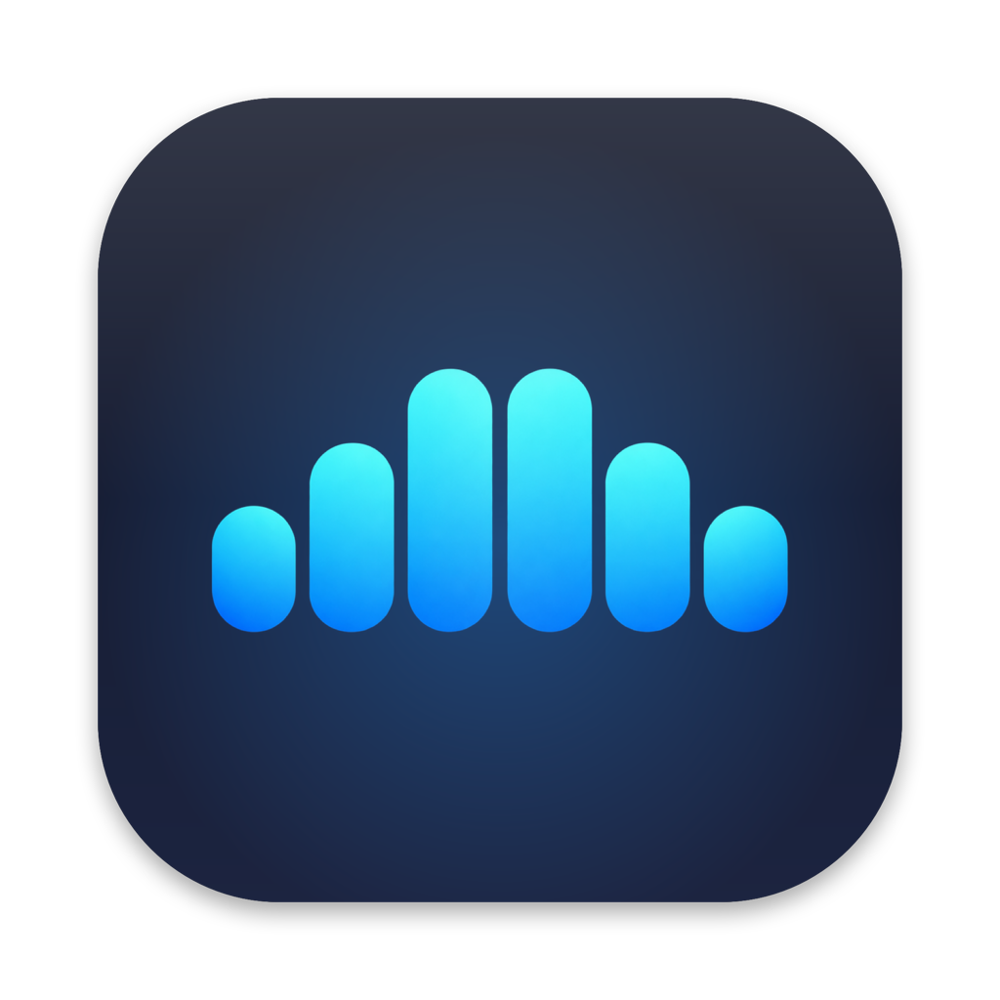
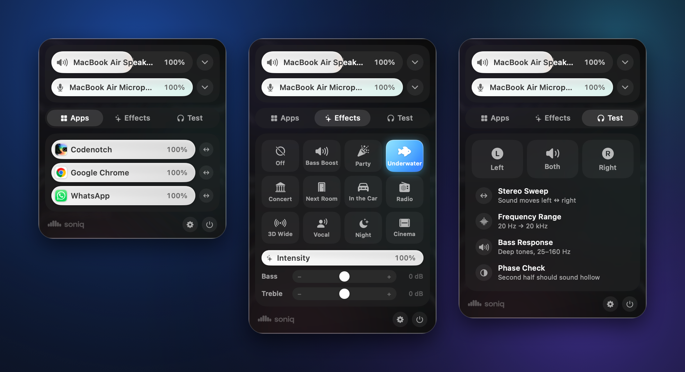
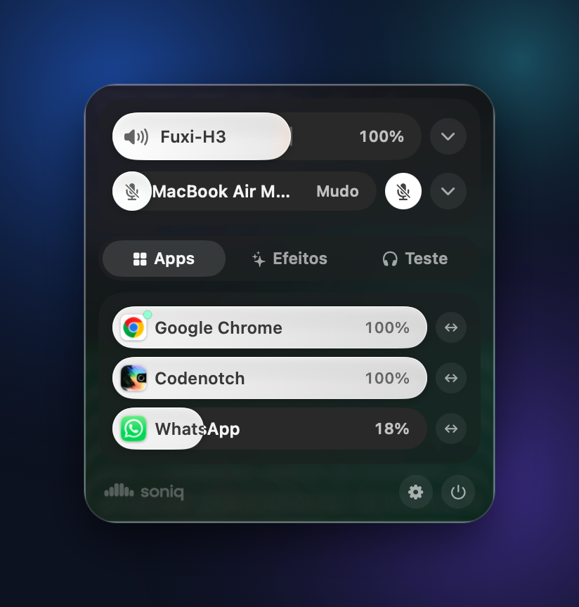
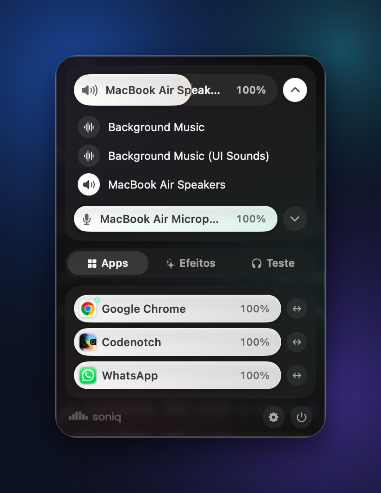
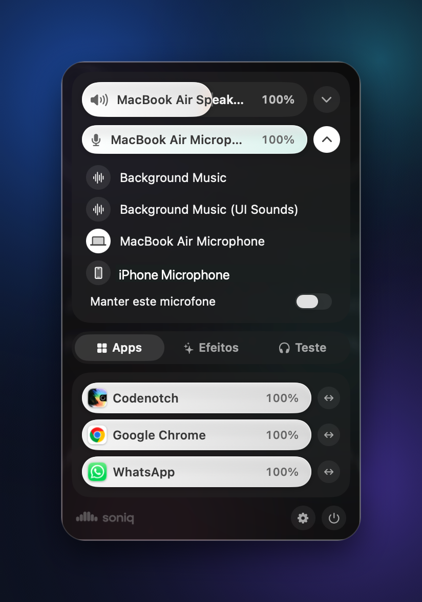
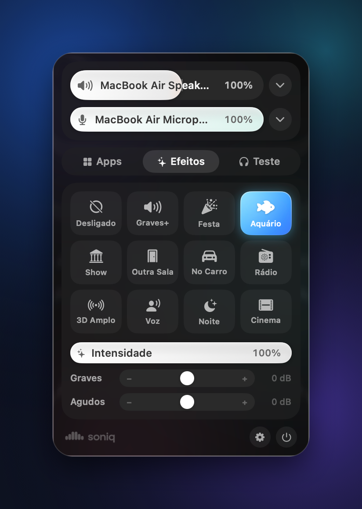
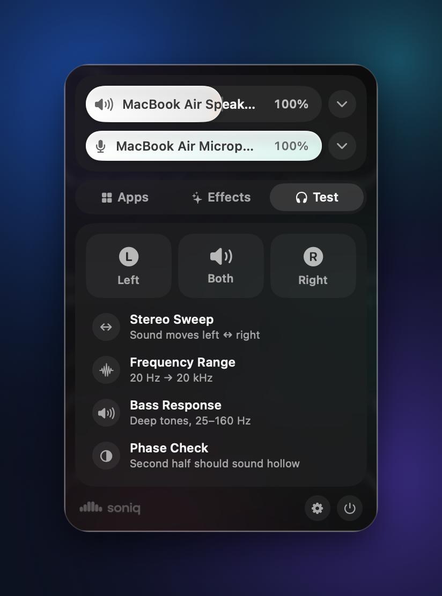
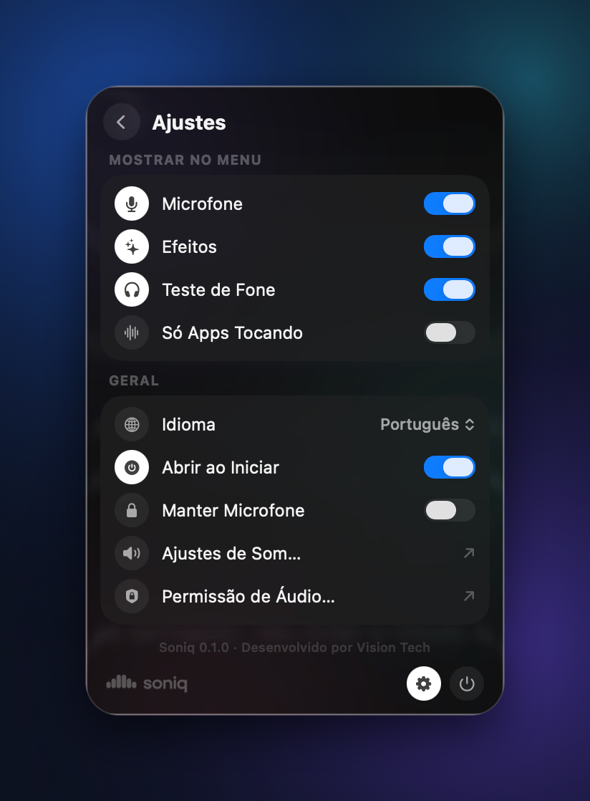

<p align="center">
  
</p>

<p align="center">
  <picture>
    <source media="(prefers-color-scheme: dark)" srcset="docs/logo-dark.png">
    
  </picture>
</p>

<p align="center">
  <strong>A central de som que o macOS deveria ter.</strong><br>
  Boost de volume até 200%, volume por app, efeitos sonoros, controle de microfone e teste de fone,<br>
  direto na barra de menus. Nativo, minimalista e sem drivers.
</p>

<p align="center"><sub>Desenvolvido por <strong>Vision Tech</strong></sub></p>

<p align="center"><strong>Português</strong> · <a href="README.en.md">English</a></p>

<p align="center">
  <a href="https://github.com/webdevpls/soniq/releases/latest"></a>
  
  
  
  <a href="LICENSE"></a>
</p>

<p align="center">
  
</p>

---

## Sumário

- [Recursos](#recursos)
- [Requisitos](#requisitos)
- [Instalação](#instalação)
- [Primeiro uso](#primeiro-uso)
- [Guia de uso](#guia-de-uso)
  - [Volume e boost](#volume-e-boost)
  - [Dispositivo de saída](#dispositivo-de-saída)
  - [Microfone](#microfone)
  - [Volume e balanço por app](#volume-e-balanço-por-app)
  - [Efeitos sonoros](#efeitos-sonoros)
  - [Teste de fone](#teste-de-fone)
  - [Ajustes](#ajustes)
- [Privacidade](#privacidade)
- [Como funciona](#como-funciona)
- [Compilando o código](#compilando-o-código)
- [Estrutura do projeto](#estrutura-do-projeto)
- [Problemas e perguntas frequentes](#problemas-e-perguntas-frequentes)
- [Próximos passos](#próximos-passos)
- [Como contribuir](#como-contribuir)
- [Licença e marca](#licença-e-marca)

## Recursos

| | |
| --- | --- |
| 🔊 **Boost de volume até 200%** | Passe do volume máximo do Mac. Um limitador transparente deixa mais alto sem estourar. |
| 🎚️ **Volume por app** | Cada app que toca som ganha o próprio controle. Silencie qualquer app com um clique. |
| ↔️ **Balanço esquerda/direita por app** | Deixe a chamada num ouvido e a música no outro. |
| ✨ **Efeitos sonoros** | Graves+, Festa, Aquário, Show, Outra Sala, No Carro, Rádio, 3D Amplo, Voz, Noite e Cinema, com intensidade, graves e agudos. |
| 🎙️ **Controle do microfone** | Escolha a entrada e ajuste o nível. *Manter este microfone* impede o macOS de trocar para o mic do fone. |
| 🎧 **Teste de fone e AirPods** | Esquerdo/direito, varredura estéreo, frequência de 20 Hz a 20 kHz, graves e fase. |
| 🔀 **Troca de saída** | Alto-falantes, fones, AirPods ou monitores em um clique. |
| 🪟 **Visual nativo** | SwiftUI com Liquid Glass no macOS 26 e materiais translúcidos no macOS 14–15. Modo claro e escuro. |
| 🌐 **Português e inglês** | Segue o idioma do Mac ou o que você escolher nos Ajustes. |
| 🪶 **Leve** | Sem extensão de kernel e sem dispositivo de áudio virtual. Apps que você não mexe nunca são interceptados. |

## Requisitos

- macOS **14.2 Sonoma** ou mais recente (visual Liquid Glass no macOS 26 Tahoe)
- Mac com Apple silicon ou Intel
- Cerca de 5 MB de espaço

## Instalação

### Download (recomendado)

1. Baixe o **`Soniq-x.y.z.dmg`** (recomendado) na [última versão](https://github.com/webdevpls/soniq/releases/latest).
2. Abra o DMG e arraste o **Soniq** para a pasta **Aplicativos**. (Também há um `.zip`, se preferir.)
3. Abra o Soniq. O ícone aparece na barra de menus, não no Dock.

> [!NOTE]
> O Soniq ainda não é notarizado pela Apple, então na primeira vez o macOS avisa que não consegue verificar o desenvolvedor.
> Vá em **Ajustes do Sistema → Privacidade e Segurança**, role até o fim e clique em **Abrir Mesmo Assim**. Isso só é preciso uma vez.
>
> Prefere o terminal? `xattr -dr com.apple.quarantine /Applications/Soniq.app`

### Compilar você mesmo

Veja [Compilando o código](#compilando-o-código).

## Primeiro uso

Na primeira vez que você usar o boost, mudar o volume de um app ou escolher um efeito, o macOS pergunta:

> *"Soniq" quer gravar o áudio deste computador.*

Clique em **Permitir**. O macOS chama essa permissão de **Gravação de Áudio do Sistema**. O Soniq precisa dela para processar o som dos outros apps antes de chegar aos alto-falantes. **Nada é gravado, salvo ou enviado.** Veja [Privacidade](#privacidade).

O macOS pergunta uma vez só. Para mudar depois, vá em **Ajustes do Sistema → Privacidade e Segurança → Gravação de Tela e Áudio do Sistema**, ou em **Soniq → Ajustes → Permissão de Áudio…**

## Guia de uso

Clique no ícone do Soniq na barra de menus para abrir o painel.

### Volume e boost



O primeiro controle é o volume do Mac.

- **0–100%** é o volume normal, o mesmo das teclas de volume.
- **100–200%** é o **boost**. O controle ganha um tom quente e o título muda para *Boost*. O Soniq amplifica todos os apps e passa o som por um limitador, então vídeos e chamadas baixos ficam mais altos sem distorcer.
- Clique no **ícone do alto-falante** para silenciar ou reativar.
- Baixar o volume pelo teclado desliga o boost automaticamente.

<br clear="right">

### Dispositivo de saída



Clique na **setinha** ao lado do volume para ver todas as saídas: alto-falantes do Mac, fones, AirPods, caixas Bluetooth, monitores e AirPlay. Clique em uma para trocar. Os efeitos e o boost acompanham o novo dispositivo.

<br clear="right">

### Microfone



O segundo controle é o **nível do microfone**. Clique no ícone do mic para silenciá-lo.

Abra a setinha dele para escolher o microfone. Ligue **Manter este microfone** para continuar no mic que você escolheu: quando um fone com microfone conecta, o macOS normalmente troca para ele (e fones Bluetooth caem para qualidade de ligação). O Soniq volta na hora para o seu.

> Algumas entradas, como o iPhone usado como microfone, não permitem mudar o nível. Nesses casos o controle fica apagado.

<br clear="right">

### Volume e balanço por app

A aba **Apps** lista todos os apps que usam áudio. Os que estão tocando aparecem primeiro, com uma bolinha verde.

- **Arraste** o controle de um app para mudar só o volume dele.
- **Clique no ícone** do app para silenciá-lo.
- Clique em **↔** para abrir o **balanço** e levar o app para o ouvido esquerdo (E) ou direito (D). Ele "gruda" no centro.

Apps que nunca fazem som (Finder, Calendário, Pré-Visualização, Terminal e parecidos) ficam escondidos. O Soniq lembra o volume, o mudo e o balanço de cada app, mesmo depois de fechar.

### Efeitos sonoros



A aba **Efeitos** muda o som de tudo. Escolha um ambiente e ajuste:

| Efeito | O que faz |
| --- | --- |
| **Desligado** | Som original |
| **Graves+** | Grave forte e encorpado |
| **Festa** | Mais grave e agudo, estéreo mais largo e um toque de ambiente |
| **Aquário** | Som abafado, como se você estivesse debaixo d'água |
| **Show** | Reverberação de casa de show e palco amplo |
| **Outra Sala** | Música tocando atrás de uma porta fechada |
| **No Carro** | Grave quente de cabine pequena |
| **Rádio** | Som estreito e levemente saturado de rádio AM |
| **3D Amplo** | Imagem estéreo extra larga |
| **Voz** | Vozes mais claras para podcasts e chamadas |
| **Noite** | Equilibra partes altas e baixas para ouvir com volume baixo |
| **Cinema** | Grave, largura e espaço para filmes |

- **Intensidade** vai do efeito suave (0%) ao completo (100%).
- **Graves** e **Agudos** somam ou tiram até 8 dB em qualquer efeito, inclusive no Desligado.

Os efeitos valem para todos os apps.

<br clear="right">

### Teste de fone



A aba **Teste** verifica fones, AirPods ou caixas de som. Com AirPods conectados, os botões mostram cada fone.

| Teste | O que observar |
| --- | --- |
| **Esquerdo / Ambos / Direito** | Toques no lado esquerdo, nos dois e no direito. Confirma que os canais não estão trocados. |
| **Varredura Estéreo** | Um tom passa suavemente de um ouvido para o outro. Falhas ou pulos indicam problema de balanço. |
| **Faixa de Frequência** | Varredura de 20 Hz a 20 kHz com leitura ao vivo. Note onde você para de ouvir. A maioria dos adultos ouve até 14–17 kHz. |
| **Resposta de Graves** | Tons de 25 a 160 Hz. Mostra até onde o fone vai no grave e se algo vibra. |
| **Teste de Fase** | O mesmo ruído em fase e depois com um lado invertido. A segunda metade deve soar "oca", dentro da cabeça. Se não soar, um canal pode estar invertido. |

Clique de novo num teste em andamento para parar.

<br clear="right">

### Ajustes



Clique na **engrenagem** para abrir os Ajustes, e em **‹** (ou Esc) para voltar.

**Mostrar no Menu**: esconda o que você não usa: Microfone, Efeitos, Teste de Fone, ou mostre só os apps que estão tocando.

**Geral**
- **Idioma**: Automático (segue o macOS), English ou Português.
- **Abrir ao Iniciar**: abre o Soniq junto com o Mac.
- **Manter Microfone**: a mesma trava da lista de microfones.
- **Ajustes de Som…**: abre os ajustes de som do macOS.
- **Permissão de Áudio…**: abre a página de privacidade de Gravação de Áudio do Sistema.

<br clear="right">

## Privacidade

- O Soniq processa o áudio **ao vivo, na memória**. Ele nunca grava, salva ou envia som.
- **Não faz nenhuma conexão com a internet**: sem analytics, sem telemetria, sem checagem de atualização.
- As configurações (volume por app, efeito escolhido) ficam só no seu Mac, em `~/Library/Preferences/io.github.soniq.plist`.
- A permissão de Gravação de Áudio do Sistema é usada só para ajustar o som dos outros apps, e só nos apps que você mudou ou enquanto o boost ou um efeito estiver ligado.

## Como funciona

O Soniq usa os **process taps do Core Audio**, uma API que a Apple lançou no macOS 14.2.

```
 Áudio do app ──► Process tap (saída original silenciada)
                       │
                       ▼
             Dispositivo agregado privado ──► ganho · balanço · efeitos · limitador ──► Seus alto-falantes
```

1. Quando um app precisa de processamento, o Soniq cria um **process tap** privado para ele com `mutedWhenTapped`. O macOS entrega o áudio do app ao Soniq e silencia a saída original.
2. Um **dispositivo agregado** privado (sua saída atual + o tap) toca o áudio pela cadeia em tempo real do Soniq: rampa de ganho → balanço → EQ de 10 bandas → filtros passa-alta/passa-baixa → saturação → largura estéreo → reverb → compressor → limitador.
3. Quando o app volta para 100%, centralizado, sem boost nem efeito, o Soniq remove o tap e o caminho original do áudio volta intacto.
4. Se o Soniq fechar ou travar, o macOS remove os taps sozinho, então o seu som nunca fica preso.

Processos auxiliares (Chrome, Safari/WebKit, apps Electron) são agrupados no app que você vê, usando o "processo responsável" do sistema.

## Compilando o código

**Requisitos:** Xcode 26 ou mais recente (Swift 6.2+). Sem outras dependências.

```sh
git clone https://github.com/webdevpls/soniq.git
cd soniq

# Opcional, uma vez: cria um certificado local de assinatura para o macOS
# lembrar da permissão de áudio entre builds (senão ele pergunta a cada build).
./scripts/setup-signing.sh

# Gera o Soniq.app universal em ./build e o .dmg e o .zip em ./dist
./scripts/build-app.sh
open build/Soniq.app
```

| Comando | Descrição |
| --- | --- |
| `swift build` | Build rápido de debug para checar se compila |
| `./scripts/build-app.sh` | Build de release, pacote do app, assinatura, DMG e zip (`VERSION=1.2.3` define a versão) |
| `swift scripts/make-icon.swift` | Gera de novo o ícone, o ícone da barra de menus e os logos a partir de `Resources/Brand` |
| `SONIQ_DEBUG=1` | Variável de ambiente que mostra no console os níveis de áudio dos taps |

> O pedido de permissão precisa do `.app` empacotado. Rodar o binário solto de `.build` atribui o acesso ao áudio ao seu terminal.

### Traduções

Os textos ficam em `Resources/<idioma>.lproj/Localizable.strings`. O texto em inglês é a chave. Para adicionar um idioma, copie `pt-BR.lproj`, traduza os valores e inclua o código em `CFBundleLocalizations` no `Info.plist` e em `AppLanguage.options`.

## Estrutura do projeto

```
Sources/Soniq
├── SoniqApp.swift              Entrada na barra de menus
├── SoniqModel.swift            Estado: apps, dispositivos, boost, efeitos, taps, preferências
├── Localization.swift          Idioma da interface
├── Audio
│   ├── AppTap.swift            Process tap + dispositivo agregado + render em tempo real
│   ├── Effects.swift           Efeitos e a cadeia de DSP (EQ, reverb, limitador…)
│   ├── HeadphoneTester.swift   Gerador dos sons de teste
│   ├── AudioSystem.swift       Dispositivos, volume, mudo, lista de processos de áudio
│   ├── AudioPermission.swift   Permissão de Gravação de Áudio do Sistema
│   ├── ProcessOwner.swift      Liga processos auxiliares ao app dono
│   └── CoreAudio+Helpers.swift Acesso tipado às propriedades do Core Audio
└── Views
    ├── SoniqView.swift         Painel, abas, apps e efeitos
    ├── TestTab.swift           Teste de fone
    ├── SettingsView.swift      Ajustes dentro do painel
    └── Components.swift        Controles, cartões de vidro, tema
Resources                       Info.plist, ícones, logos, traduções
scripts                         Build, assinatura e ícones
```

## Problemas e perguntas frequentes

<details>
<summary><strong>Um efeito ou mudança de volume não faz nada.</strong></summary>

O Soniq precisa da permissão de Gravação de Áudio do Sistema. Abra **Soniq → Ajustes → Permissão de Áudio…** e confira se o Soniq está ligado. Se você negou antes, ligue ali e abra o Soniq de novo.
</details>

<details>
<summary><strong>Um app ficou sem som.</strong></summary>

Feche o Soniq: o macOS devolve na hora o áudio original de todos os apps. Depois abra de novo e confira a permissão acima. Se continuar acontecendo, [abra uma issue](https://github.com/webdevpls/soniq/issues) com o nome do app.
</details>

<details>
<summary><strong>Aparece o indicador roxo de gravação.</strong></summary>

É o macOS mostrando que o Soniq está processando o áudio do sistema enquanto o boost, um efeito ou uma mudança por app está ativo. Some quando tudo volta ao padrão.
</details>

<details>
<summary><strong>Funciona com AirPods e caixas Bluetooth?</strong></summary>

Sim, com qualquer saída. O teste de fone mostra o fone esquerdo e o direito separados quando há AirPods conectados.
</details>

<details>
<summary><strong>Dá conflito com outros apps de áudio?</strong></summary>

O Soniq não instala dispositivo virtual, então funciona junto com a maioria das ferramentas. Se você usa um app que passa o áudio por um dispositivo virtual próprio (por exemplo Background Music ou Loopback), deixe selecionados no Soniq os seus alto-falantes ou fones de verdade.
</details>

<details>
<summary><strong>Deixa o Mac lento?</strong></summary>

Não. Apps nas configurações padrão nunca são interceptados. Processar um app usa uma fração de 1% da CPU no Apple silicon.
</details>

<details>
<summary><strong>Como desinstalo?</strong></summary>

Feche o Soniq, apague ele da pasta Aplicativos e, se quiser, remova `~/Library/Preferences/io.github.soniq.plist`.
</details>

## Próximos passos

- [ ] Efeitos por app
- [ ] Saída de áudio por app
- [ ] Atalhos de teclado globais
- [ ] Efeitos personalizados
- [ ] Homebrew (`brew install --cask soniq`)
- [ ] Builds notarizadas pela Apple
- [x] Português e inglês
- [ ] Mais idiomas (Español, …)

Tem uma ideia? [Sugira um recurso](https://github.com/webdevpls/soniq/issues/new?template=feature_request.md).

## Como contribuir

Relatos de bug, ideias e pull requests são bem-vindos. Leia o [CONTRIBUTING.md](CONTRIBUTING.md) para começar.

## Licença e marca

O Soniq é software livre sob a **[Licença Pública Geral GNU v3.0](LICENSE)** (GPL-3.0). Você pode usar, estudar, compartilhar e modificar. Se distribuir uma versão modificada, ela também precisa ser lançada sob a GPL-3.0, com o código-fonte.

O **nome e o logo Soniq não fazem parte da GPL**. Forks e redistribuições precisam usar outro nome e outro logo. Veja o [TRADEMARKS.md](TRADEMARKS.md).

<p align="center"><sub>Desenvolvido por <strong>Vision Tech</strong> · Copyright © 2026 Vision Tech</sub></p>
